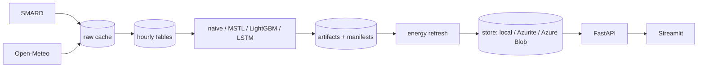

# German electricity demand forecaster

Day-ahead (next 24 hours) grid load forecasts for Germany's four transmission control areas (50Hertz, Amprion, TenneT, TransnetBW) and the national total, built from real SMARD load and Open-Meteo weather data. The project compares a seasonal naive baseline, MSTL-ARIMA, LightGBM and a PyTorch quantile LSTM, explains the LSTM with SHAP, serves forecasts with FastAPI and Streamlit, runs in Docker, and ships Azure infrastructure code that you deploy yourself.

Every number below is read from a file in `results/` (named in brackets). Nothing here was typed from memory.

## Summary

Test period: 2024-01-01 to 2026-10-11, 1014 forecast days per zone, models frozen before the test split was run (`results/ladder.csv`, national total `DE`, reanalysis weather):

| Model | MAE (MW) | 95% CI of MAE (7-day block bootstrap) | MAPE (%) | MASE |
| --- | --- | --- | --- | --- |
| Seasonal naive, previous day (48 h fallback) | 5411 | 5296 to 5519 | 10.34 | 2.24 |
| Seasonal naive, same hour last week | 2696 | 2450 to 2950 | 5.16 | 1.12 |
| MSTL-ARIMA (weekly refit) | 2067 | 1892 to 2232 | 4.01 | 0.86 |
| **LightGBM** | **1306** | 1255 to 1358 | 2.49 | 0.54 |
| LSTM (seed 0) | 1510 | 1450 to 1565 | 2.87 | 0.63 |

* **LightGBM is the most accurate model in all five zones.** For the national total the LSTM's MAE is 204 MW worse than LightGBM's (CI of the difference 151 to 248 MW, Diebold-Mariano with Harvey correction p < 0.001, `results/significance.csv`). Over five seeds the LSTM's MAE is 1507 plus or minus 55 MW (`results/seed_spread.csv`), so the gap is far larger than seed noise.
* The LSTM is clearly better than every non-boosting baseline (for example 557 MW better than MSTL-ARIMA, CI 401 to 705 MW).
* The LSTM is still the model that is served and explained, for a stated reason: the SHAP explanation requirement and a single network with a monotone quantile head. Its probabilistic quality does not beat LightGBM's (pinball loss at 0.5: 755 versus 653 MW), so if you only need accuracy, use the LightGBM artifact. See `docs/MODEL_CARD.md`.
* Archived-forecast weather (the realistic regime) gives almost the same error as reanalysis weather: LSTM 1504 versus 1510 MW, LightGBM 1305 versus 1306 MW. That small gap probably says more about the Historical Forecast API (its early model hours are close to an analysis) than about weather not mattering: removing weather from the LSTM costs 123 MW (1633 versus 1510 MW, `results/ablations.csv`).

## Architecture



Full diagrams and module map: `docs/ARCHITECTURE.md`. A study guide that walks through the whole project, with figures, self-test questions and a re-implementation plan, is `docs/STUDY_GUIDE.pdf` (rebuild it with `python scripts/make_study_guide.py`; every number in it is read from `results/`).

## Quick start (local, no cloud account)

```bash
pip install -r requirements.txt && pip install -e .        # Python 3.11 or newer, CPU PyTorch
energy fetch --what load && energy fetch --what weather    # tens of minutes, cached and resumable
energy fetch --what generation                             # optional (lagged-generation ablation, EDA): about 2 h here
energy build-dataset
energy train && energy backtest --splits val,test && energy report
```

Serve what you trained (the refresh job needs network access for live inputs):

```bash
energy publish-models && energy refresh && energy serve-api   # then: streamlit run app/streamlit_app.py
```

Run times measured on this laptop are in HANDOFF.md and `results/runtime.json`. The weekly briefing needs an optional local language model: `pip install llama-cpp-python --extra-index-url https://abetlen.github.io/llama-cpp-python/whl/cpu` plus the GGUF file `models/qwen2.5-3b-instruct-q4_k_m.gguf` (from the Qwen/Qwen2.5-3B-Instruct-GGUF repository on Hugging Face), or a running Ollama with `qwen2.5:3b-instruct`. Without either, briefings fall back to the deterministic template.

## Data

* **SMARD** (Bundesnetzagentur, `smard.de`): grid load (filter 410) per control area and nationally, hourly, 2015-01-01 to 2026-10-12 (103,266 to 103,267 rows per zone); the published day-ahead forecast (filter 411) as a labelled external benchmark; generation by source for the lagged-generation ablation. Licence: the data is published under CC BY 4.0, attribution "Bundesnetzagentur | SMARD.de". The licence text was not re-read from the site during this build, so confirm it on smard.de before redistributing data. The chunk endpoint is documented by the community project bundesAPI/smard-api (unofficial). A CSV export importer exists and agrees with the JSON parser on a real export week.
* **Open-Meteo** (Zippenfenig, 2023): the reanalysis archive (ERA5 based; Hersbach et al., 2023), the Historical Forecast API (from 2021-01-01) and the live forecast API. Free for non-commercial use with attribution. Generated using Copernicus Climate Change Service information. This is a non-commercial portfolio project.
* Weather per zone is a population-weighted mean over 3 to 5 cities (`configs/zones.yaml`, approximate populations); holidays use the `holidays` package per state with approximate state population shares.

Data quality (`results/data_quality.json`): no missing hours, no duplicate timestamps, no short-gap interpolation needed, 2 outlier hours flagged (TransnetBW), 551 hours on the 23 and 25 hour DST days per zone. The sum of the four zones differs from the national total by 0.147% on average (99th percentile 2.33%, maximum 12.2%). EDA figures are in `results/figures/eda/`; COVID-19 weeks and the 2022 energy-crisis year are visible as level shifts (`covid_and_crisis.png`).

## Method

**Task.** Forecast issue time is 10:00 Europe/Berlin on day D. The forecast covers the 24 hours of day D+1 (24 consecutive UTC hours from local midnight; 23 and 25 hour days are handled and tested). Inputs: load up to the last complete hour before issue, observed weather up to issue, weather forecast for D+1, calendar. Tests assert that no feature reads data after the issue time, including a perturbation test that overwrites the future.

**Splits.** Train 2015 to 2022, validation 2023, test 2024 to the last complete day. Hyperparameters, early stopping and interval calibration use validation only.

**Models** (`src/energy/models`): seasonal naive; MSTL (daily and weekly seasonality) with an AutoARIMA trend via statsforecast; LightGBM (one model per zone, relative load targets, quantile models for 10% and 90%); an LSTM over the past 168 hours with hour, weekday and holiday embeddings and a known-ahead block, quantiles 0.1, 0.5, 0.9 with pinball loss, one model per zone, plus one pooled model with a zone embedding.

## Results

All numbers are for the test period, reanalysis weather unless stated.

**Ladder per zone** (`results/ladder.csv`), MAE in MW:

| Zone | naive week | MSTL-ARIMA | LightGBM | LSTM | pooled LSTM |
| --- | --- | --- | --- | --- | --- |
| 50Hertz | 891 | 740 | 529 | 552 | 530 |
| Amprion | 1105 | 840 | 631 | 670 | 638 |
| TenneT | 825 | 642 | 419 | 493 | 453 |
| TransnetBW | 436 | 325 | 187 | 201 | 197 |

The pooled LSTM is better than the per-zone LSTM in all four zones (single pooled run against seed 0 of the per-zone model; per-zone seed standard deviations are 6 to 12 MW, the gaps are 4 to 40 MW), and close to LightGBM for 50Hertz.

**External reference** (`results/external_benchmark.csv`): the published SMARD day-ahead consumption forecast has an MAE of 1977 MW (3.78% MAPE) for the national total on the same days, against 1306 MW for LightGBM. This does not show that LightGBM beats the operators: the definition and issue time of the published forecast are not documented here, and this project assumes zero publication latency for the latest observed load (optimistic).

**Probabilistic calibration.** The 80% interval was widened or narrowed by one constant fit on validation (conformal). On the test period the empirical coverage is still below 80%: national LSTM 71.9%, LightGBM 69.5% (uncalibrated 59.1% and 56.2%). Demand drifted away from the validation year, so the validation-calibrated intervals are too narrow on the test period. Mean 80% interval width: LSTM 3975 MW, LightGBM 3692 MW.

**Breakdowns** (national, `results/breakdowns.csv`, MAE in MW, LightGBM versus LSTM): weekdays 1330 versus 1593; weekends 1213 versus 1291; public holidays 1664 versus 1688; coldest 5% of days 1449 versus 1328 (the LSTM is better here); hottest 5% of days 1216 versus 1617; within one day of a DST change 1446 versus 1511. By year, LightGBM: 2024 1255, 2025 1254, 2026 1440.

**Ablations** (national LSTM unless stated, test MAE in MW, `results/ablations.csv`): baseline 1510; no weather 1633; no calendar embeddings 1971; lookback 72 h 1475 and 336 h 1472 (differences below seed noise of 55 MW); trained without 2020 1653; trained without 2022 1583. LightGBM with lagged generation features (lags of at least 48 hours) 1272 versus 1306 without; LightGBM without weather 1447.

**Parallel training** (`results/parallel_timing.json`, 4 zones, same LSTM, 6 epochs each): sequential with 1 thread 424 s, sequential with all threads 256 s, Dask with 4 worker processes of 1 thread 234 s (startup 2 s). Speed-up 1.8 times over the 1 thread run and 1.1 times over the multi-threaded sequential run, at 3.5 GB peak memory against 1.0 to 1.1 GB. The reason is that PyTorch already uses several cores in the sequential run, so extra processes mostly add memory. Predictions of the sequential 1 thread run and the Dask run are identical (maximum difference 0.0 MW). A SMARD download was running during these timings.

**Explainability** (`results/explain_sanity.json`, national LSTM, 200 validation days, SHAP GradientExplainer with 100 training windows as background, plots in `results/figures/explain/`):

| Check | Result |
| --- | --- |
| Additivity (attributions plus base value versus model output) | mean gap 794 MW, 17.2% of the mean output deviation: **fails** my own 10% threshold |
| Agreement with permutation importance | Spearman 0.90, same top-5 features |
| Direction: lower winter temperature raises demand attribution | holds (Spearman -0.99, 48 winter days) |
| Direction: weekend lowers demand attribution | holds (mean -5601 MW versus +2562 MW on weekdays) |
| Stability across 3 background samples | mean Spearman 0.985, top-5 overlap 0.87 |

Attributions explain the model, not the physical causes of demand.

## Weekly briefing

Aggregation is deterministic code (`src/energy/briefing/aggregate.py`): per zone the expected weekly peak and its hour, energy, change against the previous week, mean 80% interval width, the top 3 SHAP drivers of the peak hour and data quality flags. A local language model (llama-cpp-python with a Q4 GGUF of Qwen2.5 3B Instruct, temperature 0; Ollama was not installed on this machine) turns the facts into a structured briefing (Pydantic schema), one call per zone plus one overview call. `briefing/verify.py` checks that every number matches a value in the facts within rounding (including GW versus MW) and that every zone and driver named exists; a failing section is regenerated with an explicit instruction up to 2 times, then replaced by a deterministic template with a visible flag.

Evaluation (`results/briefing_eval.json`, details in `results/briefing_eval_details.jsonl`): **20 evenly spaced weeks of the 144 available test weeks, not about 100**, because one briefing takes about 288 s on this CPU (mean per briefing, six model calls). Pass rate at the first attempt (all six sections verified without retry): 65% (13 of 20). Pass rate after up to 2 retries: 90% (18 of 20). Template fallback: 10% (2 weeks, one section each: 50Hertz for the week of 2026-01-12 and Amprion for 2026-03-09). Every failed check was a number that was not in the facts (14 occurrences across all attempts). The verification is a consistency check on numbers and names only; it does not check that the wording is sensible or that the SHAP drivers are causes. The drivers come from SHAP, which is stochastic, so a re-run gives slightly different attributions.

## Serving

```bash
curl -s "http://127.0.0.1:8000/v1/forecast?zone=DE"
curl -s "http://127.0.0.1:8000/v1/explain?zone=DE&hour=8"
curl -s "http://127.0.0.1:8000/v1/ready"
```

Endpoints: `/v1/health`, `/v1/ready`, `/v1/zones`, `/v1/forecast?zone=&issue_time=`, `/v1/explain?zone=&hour=`, `/v1/briefing/latest`, `/v1/history`, `/v1/results/{name}`, `/metrics`. Zone whitelist, issue time bounds, JSON error schema without stack traces, optional `X-API-Key` (set `ENERGY_API_KEY`), CORS off by default, request timeouts, JSON logs with request ids. The refresh job refuses to publish when inputs are stale or fail checks; the API then keeps serving the last good forecast with `stale: true`. The Streamlit app (`app/streamlit_app.py`) talks to the API over HTTP only.

## Docker

```bash
docker compose -f docker/docker-compose.yml up --build -d          # api, app, azurite
energy publish-models --store azurite && energy refresh --store azurite
```

Images: API 531 MB (no PyTorch, no data), app 929 MB; non-root user, health checks, memory limits 512 MB per service. The full stack was run here against Azurite (see HANDOFF.md).

## Azure

Bicep, scripts, an Azure DevOps pipeline and a GitHub Actions mirror are in `infra/azure/`, `azure-pipelines.yml` and `.github/workflows/ci.yml`. They were written and statically checked but **not executed or compiled**. Guide, account options, current free allowances and safety rules: `docs/AZURE_DEPLOY.md`.

## Limitations

* Control area weather is an approximation (3 to 5 cities, approximate weights).
* Reanalysis weather is optimistic relative to real forecasts; the archived-forecast regime is also close to an analysis (see above).
* The 2020 and 2022 regime shifts matter: removing either year from training makes the test error worse (1653 and 1583 MW versus 1510 MW), and the test years drift away from the validation year (2026 error is higher than 2024 and 2025 for both main models).
* Behind-the-meter solar and heat pumps are not modelled explicitly.
* Results come from one machine and one test period.
* SHAP explains the model, not causes; its additivity gap here is 17% of the output deviation.
* The LLM briefing is a presentation layer verified only for numeric and naming consistency.
* Free cloud allowances change; costs could occur if limits are exceeded.
* Azure deployment was written and statically checked, and is executed only by you.
* Intervals are under-covering on the test period (70 to 75% for a nominal 80%).

## Reproduction

Follow the quick start; the exact commands and measured run times are in HANDOFF.md. Versions are pinned in `requirements.txt` (older, widely distributed releases because the build machine's Windows Application Control blocked newly released wheels). Seed 0 everywhere; LightGBM runs deterministic; PyTorch runs depend on thread count in the last digits.

## References

* Zippenfenig, P. (2023). Open-Meteo.com Weather API. Zenodo, doi:10.5281/zenodo.7970649.
* Hersbach, H. et al. (2023). ERA5 hourly data on single levels from 1940 to present. Copernicus Climate Change Service Climate Data Store.
* Bundesnetzagentur, SMARD.de market data portal.
* Romano, Y., Patterson, E., Candes, E. (2019). Conformalized quantile regression. NeurIPS.
* Diebold, F. and Mariano, R. (1995). Comparing predictive accuracy. Harvey, D., Leybourne, S., Newbold, P. (1997). Testing the equality of prediction mean squared errors.
* Lundberg, S. and Lee, S. (2017). A unified approach to interpreting model predictions (SHAP).
* Bandara, K. et al. (2021). MSTL: a seasonal-trend decomposition algorithm for time series with multiple seasonal patterns.
