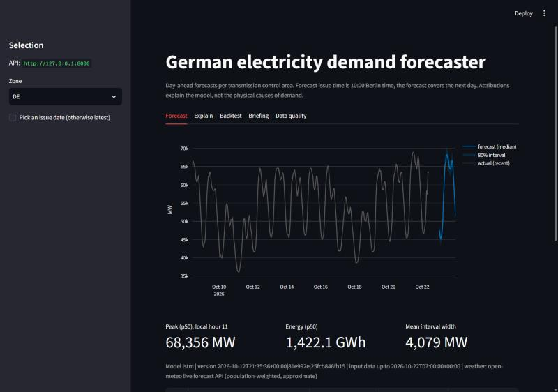
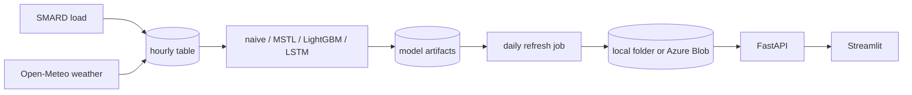

# German electricity demand forecaster

Day-ahead load forecasts for Germany: every morning at 10:00 the model predicts the 24 hourly
values of the next day, for the national total and for each of the four transmission zones
(50Hertz, Amprion, TenneT, TransnetBW). Load data comes from SMARD (Bundesnetzagentur), weather
from Open-Meteo.

I built it to compare a classic statistical model, gradient boosting and an LSTM on the same
honest backtest, and then to take one model all the way to an API and a small dashboard.



## Results

Train on 2015 to 2022, tune on 2023, test on 2024-01-01 to 2026-10-11 (1,014 forecast days). The
test period was run once, after the models were frozen. National total, mean absolute error:

| Model | MAE (MW) | MAPE |
| --- | --- | --- |
| Naive: same hour last week | 2696 | 5.16% |
| MSTL + ARIMA | 2067 | 4.01% |
| **LightGBM** | **1306** | **2.49%** |
| LSTM (PyTorch, quantile outputs) | 1510 | 2.87% |

Things I did not expect:

- **LightGBM beat the LSTM in every zone.** The 204 MW gap on the national series is far outside
  seed noise (LSTM over five seeds: 1507 ± 55 MW) and significant in a Diebold-Mariano test.
- One LSTM trained on all zones together (with a zone embedding) was better than a separate LSTM
  per zone, and got close to LightGBM for 50Hertz.
- Calendar information matters more than weather: dropping the calendar embeddings costs the LSTM
  about 460 MW, dropping weather about 120 MW.
- The 80% prediction intervals are too narrow on the test years (around 70% coverage) even after
  conformal calibration, because demand drifted after the calibration year.
- Training four zone models in parallel with Dask was only 1.1x faster than plain PyTorch using
  all cores, at three times the memory. PyTorch was already parallel.

The app serves the LSTM anyway, because I wanted one network with quantile outputs that I could
explain with SHAP. If you only care about accuracy, use the LightGBM model. More numbers
(per zone, by weekday/holiday/temperature, ablations, calibration) are in `results/` and in the
[model card](docs/MODEL_CARD.md).

## How it works



- **No leakage.** A forecast issued at 10:00 only sees load up to the last complete hour, observed
  weather up to then, the weather forecast for tomorrow and the calendar. There is a test that
  overwrites all future data and checks that no feature changes.
- **Models** live in `src/energy/models/`. The LSTM reads the last 168 hours and outputs the 10%,
  50% and 90% quantiles for each of the next 24 hours.
- **Explanations**: SHAP for the LSTM, with sanity checks. One of them (additivity) fails my own
  threshold, and I say so in the model card instead of hiding it.
- **Weekly briefing**: a small local LLM (Qwen2.5 3B) turns the forecast numbers into a short
  text. Every number it writes is checked against the data, and a plain template is used if the
  check keeps failing.
- **Serving**: a refresh job writes the latest forecast to a store, the API only reads from that
  store. If fresh data is missing or looks wrong, the API keeps serving the last good forecast and
  marks it as stale.

## Running it

Python 3.11+, CPU is enough.

```bash
pip install -r requirements.txt && pip install -e .

energy fetch --what load        # SMARD, a few minutes per series
energy fetch --what weather     # Open-Meteo, about 15 minutes
energy build-dataset
energy train
energy backtest --splits val,test
energy report
```

Serve what you trained:

```bash
energy publish-models && energy refresh
energy serve-api                       # http://127.0.0.1:8000/docs
streamlit run app/streamlit_app.py
```

Or with Docker (API, app and a local Azure Blob emulator):

```bash
docker compose -f docker/docker-compose.yml up --build -d
energy publish-models --store azurite && energy refresh --store azurite
```

Tests: `pytest`. Lint and types: `make gate`.

On my laptop (Ryzen 5, 8 GB RAM, no GPU) one LSTM takes 6 to 15 minutes to train and LightGBM
about 15 seconds per zone.

## Azure

`infra/azure/` has Bicep templates and deploy/teardown scripts for running the API as a container
with Blob storage, and there is an Azure DevOps pipeline next to the GitHub Actions one. I wrote
and reviewed them but have **not deployed them**, so treat them as a starting point. Notes on cost
safety are in [docs/AZURE_DEPLOY.md](docs/AZURE_DEPLOY.md).

## Limitations

- Weather per zone is an average over 3 to 5 cities, which is rough.
- The "archived forecast" weather I used for the realistic test is close to actual weather, so it
  flatters the models a little.
- I assume the latest load value is available immediately. In reality SMARD publishes with a delay.
- Results come from one machine and one test period.

More: [architecture](docs/ARCHITECTURE.md), [design decisions](docs/DECISIONS.md),
[known issues](docs/KNOWN_ISSUES.md).

## Data and references

- Load: Bundesnetzagentur | SMARD.de (CC BY 4.0)
- Weather: Open-Meteo (Zippenfenig, 2023), based on ERA5 (Hersbach et al., 2023)
- Romano, Patterson, Candes (2019), Conformalized quantile regression
- Diebold and Mariano (1995), Comparing predictive accuracy
- Lundberg and Lee (2017), SHAP
- Bandara et al. (2021), MSTL
