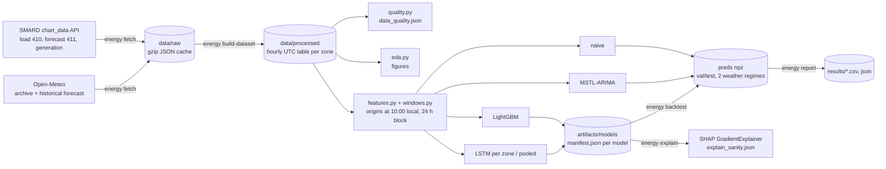
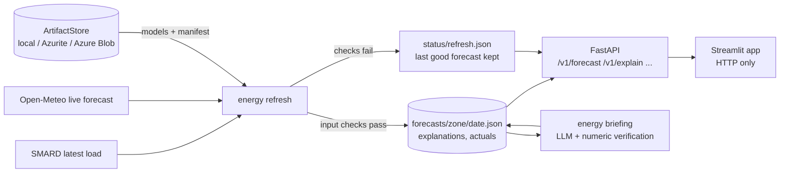

# Architecture

This matches what is implemented in `src/energy`, `api` and `app`.

## Data and training flow

## Serving flow

## Modules

| Area | Modules |
| --- | --- |
| Data | `data/smard.py`, `data/smard_csv.py`, `data/openmeteo.py`, `data/build.py`, `data/quality.py`, `data/eda.py`, `calendar_features.py` |
| Samples | `windows.py` (origins and 24 h blocks), `features.py` (features with provenance), `splits.py` |
| Models | `models/naive.py`, `stat_mstl.py`, `gbm.py`, `lstm.py`, `pooled_lstm.py`, all with `fit`, `predict`, `predict_quantiles` |
| Training | `training/train.py`, `hpo.py`, `parallel.py` (Dask), `ablations.py`, `manifest.py` |
| Evaluation | `evaluation/metrics.py`, `backtest.py`, `runner.py`, `intervals.py` (conformal calibration), `significance.py`, `analysis.py` |
| Explainability | `explain/shap_lstm.py`, `sanity.py`, `plots.py` |
| Serving | `store/*`, `serving/live.py`, `refresh.py`, `forecast_service.py`, `api/*`, `app/streamlit_app.py` |
| Briefing | `briefing/aggregate.py`, `llm.py`, `verify.py`, `evaluate.py` |

## Key invariants

* Everything is stored in UTC; calendar features use Europe/Berlin local time of each hour.
* A forecast origin reads load and observed weather only at or before the last complete hour before issue time (tested by provenance checks and by perturbing the future).
* Scaling statistics are fit on the training period only (stored in the LSTM artifact).
* The API refuses artifacts whose manifest is missing, incomplete or inconsistent with the file hashes (the refresh job validates them before forecasting; the API only serves what the refresh job published).
